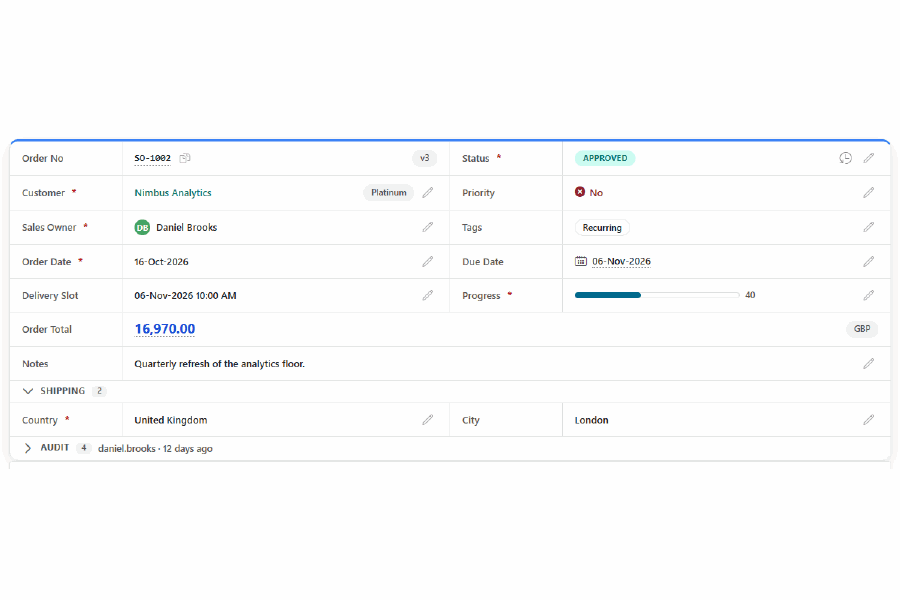
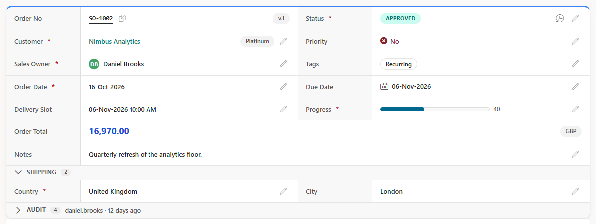
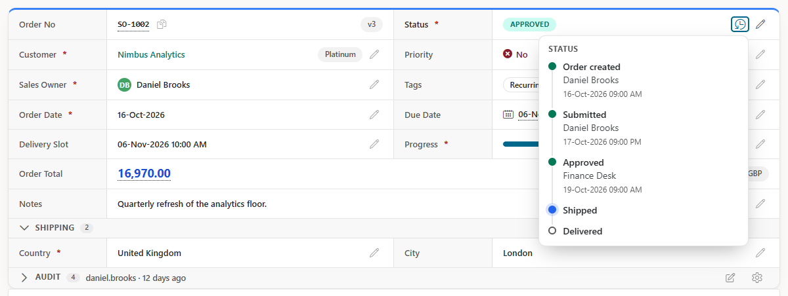
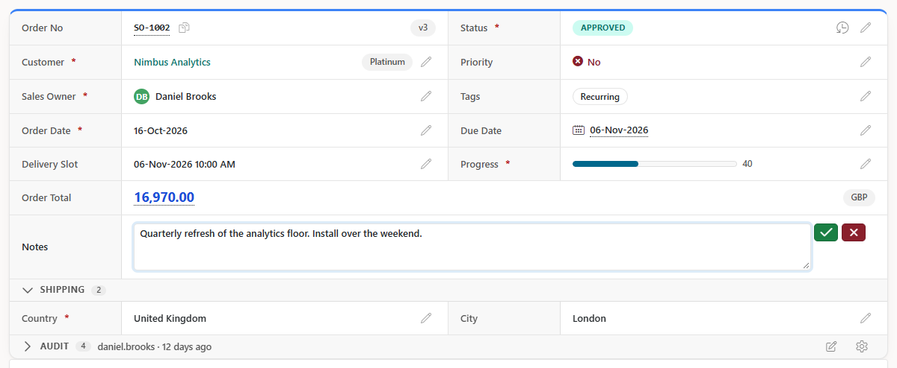
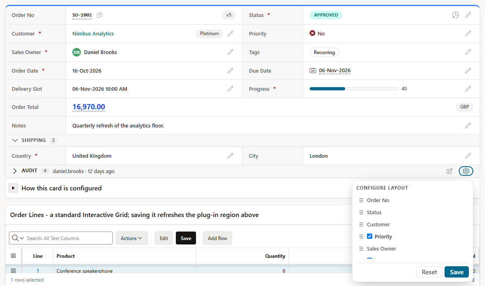

# Smart 1-Row View for Oracle APEX

[](https://apex.oracle.com) [](LICENSE) [](CHANGELOG.md)

A region plug-in that shows one record as a clean label-and-value card - and lets people edit it in place. The layout you keep hand-building with two report regions and a pile of CSS, set up in Page Designer instead.



**[Live demo](https://oracleapex.com/ords/r/hashaam-admin/apex-plugins-by-hbs/order)** (demo / Demo@2026) · [Install](#install) · [Add a region](#add-a-region) · [Inline editing](#inline-editing) · [Per-user layouts](#per-user-layouts-optional) · [Changelog](CHANGELOG.md) · [Issues](https://github.com/HashaamShoukat/apex-plugin-smart-1row-view/issues)

## Features

- **Layout** - 1 to 3 label / value pairs per row; a field can span two pairs or the full row, merge with its label, or both; forced columns; stacks on phones.
- **Sections** - collapsible groups inside the card, with a summary when closed.
- **Value displays** - badges in five variants, chips, avatars, Yes / No checks, large numbers, percent bars, relative time, monospace, HTML expressions.
- **Colour rules** - `Draft=grey; Approved=green; >=50000=green; *=blue` - no extra SQL columns.
- **Side badges, icons, tooltips, copy buttons and blink** - each driven by a literal or a `#COLUMN#` token, so it varies per record.
- **Format masks** - any Oracle mask, plus `COMPACT`, `PERCENT`, `CURRENCY:#CURRENCY_CODE#` and `SINCE`.
- **Inline editing** - text field, text area, number, date, date and time, select list, searchable list, toggle switch; validation in the browser and again on the server.
- **Whole-card edit**, a **conflict check** (version column) and **Undo**.
- **Dependent lists** - a list follows another field's unsaved value.
- **Links** with the native Link Builder, exactly like report column links (modal pages included).
- **Details popover** - a timeline loaded on demand.
- **Region refresh** and **per-user layouts** (drag fields into a new order, hide optional ones), applied on the server so the card never jumps.
- **Secure saves** - the browser only sees a session-bound token; the record key is resolved on the server, so a user can never switch to another record or column.

No templates, no hand-written CSS, no third-party libraries. Requires **APEX 24.1 or later** (built and tested on 26.1) and Oracle Database 19c or later.

| | |
|---|---|
|  |  |
| One order: badges, avatar, chips, percent bar, sections | A status timeline, loaded when it is opened |
|  |  |
| Editing a field in place | Each user arranges the card for themselves |

---

## Install

1. **Database objects.** As the application's parsing schema run `@db/install.sql`. It creates
   - `SMART1ROWVIEW_PKG` - renders the card, answers its Ajax calls (refresh, list values, popovers) and checks edit tokens and validation rules on save (always needed);
   - `SMART_1ROW_PREFS` + `SMART_1ROW_PREFS_PKG` - each user's card layout (only for *Allow User Configuration*).

   Safe to run again. `@db/uninstall.sql` removes them.
2. **Plug-in.** Shared Components > Plug-ins > Import:
   - `plugin/region_type_plugin_com_hashaam_smart_1row_view.sql` for APEX 26.1 and later;
   - `plugin/region_type_plugin_com_hashaam_smart_1row_view_24.1.sql` for APEX 24.1 and 24.2 (the same plug-in without the APEXlang-only names).

The internal name is `COM.HASHAAM.SMART_1ROW_VIEW`; the callbacks are `smart1rowview_pkg.render_region` and `.ajax_region`. The CSS and JavaScript ship inside the plug-in (`src/` has the same files).

## Add a region

1. Create a region of type **Smart 1-Row View**.
2. Give it a SQL query that returns one row, e.g. `select * from my_orders where order_id = :P3_ORDER_ID`. Every column becomes a label and a value; list `P3_ORDER_ID` in *Page Items to Submit*.
3. Pick the region settings: pairs per row, label width, density, frame, label style, striped rows, accent and custom colours.
4. Set each column (Page Designer > region columns). Hide helper columns and use them as `#COLUMN#` tokens in other columns' settings.

### Column settings

| Setting | What it does |
|---|---|
| Span | Single slot, two pairs, full row, merge with label (the value takes the label's cell), or full row without label |
| Placement | Auto, or force column 1, 2 or 3 |
| Value Display | Plain text, monospace, badges (soft, solid, outline, dot, bar), chips, avatar and name, Yes / No check, large number, percent bar, relative time, HTML expression |
| Colour Rules | `Draft=grey; Approved=green; >=50000=green; *=blue` |
| Format Mask | Any Oracle mask, plus `COMPACT`, `PERCENT`, `CURRENCY:#CURRENCY_CODE#` and `SINCE` |
| Bold, Italic, Underline, Highlight / Value / Badge colours | Text styling, literal colours or `#COLUMN#` |
| Side Badge, Icon, Icon Click Message, Tooltip Text, Show Copy Button, Blink When | Extra details in the same cell, each driven by `#COLUMN#` tokens |
| Hide If Null | Leaves the field out when it is empty |
| Link, Link Attributes | The standard Link Builder, the same as a report column link |
| Section, In Section Summary | Groups fields under a collapsible header; a collapsed section can show a summary |
| Details Popover Query | Rows loaded on demand into a popover, shown as a timeline (title, detail, when, state) |
| Editable, Editable LOV Query, Switch Values, Editable When, Validation | Inline editing - see below |
| User Configurable | Always show, Shown initially or Hidden initially (per-user layouts) |

### Region settings

| Setting (default) | |
|---|---|
| Report Layout (2 columns = 1 pair) | 1, 2 or 3 label / value pairs per row |
| Label Column Width (160px), Density (Cozy), Frame (Card), Label Style, Striped Rows, Stack On Mobile (Yes) | Look |
| Accent, Border, Label Background / Text, Value Text Colour, Corner Radius, Border Style | Colours and borders |
| Copy Icon Class (`fa fa-copy`), Collapsed Sections | Details |
| Edit Handler Call, Whole Card Edit, Version Column | Inline editing |
| Allow User Configuration, Preferences Process Name (`SMART_1ROW_PREFS`), Record Key Column | Per-user layouts |
| Debug Mode | Shows what the plug-in received (columns, layout, edit call) above the card - for building the page |

Standard attributes: Page Items to Submit, Order By, Number of Rows, No Data Found Message, Escape special characters, Initialization JavaScript Function, and column Heading, alignment, CSS classes and custom attributes.

## Inline editing

Set a column's **Editable** to an editor and add **Validation** rules (`required; min=0; max=100; maxlength=400`) and an optional **Editable When** token. The plug-in checks the rules in the browser and again on the server.

The region's **Edit Handler Call** is one JavaScript expression that saves one field. It gets `newValue` and `ctx` (`ctx.column`, `ctx.oldValue`, `ctx.token`, `ctx.version`) and returns `{ status, message, version }` or a promise of it. On success the card re-renders from the database and offers Undo.

Edit Handler Call (region setting):

```js
saveOrderField(ctx.token, ctx.column, newValue, ctx.version)
```

Page JavaScript (Function and Global Variable Declaration):

```js
async function saveOrderField(token, columnName, newValue, version) {
    const res = await apex.server.process("SAVE_FIELD", {
        x01: token, x02: columnName,
        x03: newValue == null ? "" : String(newValue),
        x04: version == null ? "" : String(version)
    }, { dataType: "json" });
    return { status: res.status, message: res.message, version: res.version };
}
```

Ajax Callback process `SAVE_FIELD`. `resolve_key` turns the token back into the record key, checks that the column is editable in that region and applies its validation rules - so the browser can never pick another record or column:

```sql
declare
    l_id number := to_number(smart1rowview_pkg.resolve_key(
                       apex_application.g_x01,          -- token
                       upper(apex_application.g_x02),   -- column
                       apex_application.g_x03));        -- new value
begin
    case upper(apex_application.g_x02)
        when 'STATUS' then
            update my_orders set status = apex_application.g_x03 where order_id = l_id;
        -- one branch per editable column
        else raise_application_error(-20001, 'Not editable.');
    end case;
    apex_json.open_object;
    apex_json.write('status',  'SUCCESS');
    apex_json.write('message', 'Saved.');
    apex_json.close_object;
end;
```

- **Whole-card edit** - one switch adds *Edit all*; every field opens and Ctrl+Enter saves them together.
- **Conflict check** - set *Version Column* (e.g. `ROW_VERSION`) and return `CONFLICT` when it no longer matches.
- **Dependent lists** - a list query that uses `#SHIP_COUNTRY#` reloads when that field changes, before it is saved.
- **Refresh** - a Refresh dynamic action or `apex.region("id").refresh()` re-renders the card in place. If the query fails, the error is shown inside the region (with the database message in a Builder session) instead of failing the page.

## Per-user layouts (optional)

Turn on **Allow User Configuration**, set **Record Key Column** and create an Ajax Callback process with the name in **Preferences Process Name** (default `SMART_1ROW_PREFS`). Users then get a gear in the card's last cell to drag fields into a new order and hide optional ones. Their choice is stored per user, page and region, and applied on the server, so the card never jumps after it loads. Mark a column *Shown initially* or *Hidden initially* to let users hide it.

Application process `SMART_1ROW_PREFS` (Ajax Callback):

```sql
-- x01 = GET / SAVE / RESET, x02 = region key, x03 = hidden, x04 = order
begin
    case apex_application.g_x01
        when 'GET' then
            sys.htp.prn(smart_1row_prefs_pkg.get_prefs(
                p_app_id => :APP_ID, p_page_id => :APP_PAGE_ID,
                p_region_key => apex_application.g_x02, p_username => :APP_USER));
        when 'SAVE' then
            smart_1row_prefs_pkg.save_prefs(
                p_app_id => :APP_ID, p_page_id => :APP_PAGE_ID,
                p_region_key => apex_application.g_x02, p_username => :APP_USER,
                p_hidden => apex_application.g_x03, p_order => apex_application.g_x04);
            apex_json.open_object; apex_json.write('status', 'OK'); apex_json.close_object;
        when 'RESET' then
            smart_1row_prefs_pkg.reset_prefs(:APP_ID, :APP_PAGE_ID, apex_application.g_x02, :APP_USER);
            apex_json.open_object; apex_json.write('status', 'OK'); apex_json.close_object;
    end case;
end;
```

## Demo application

The **[live demo](https://oracleapex.com/ords/r/hashaam-admin/apex-plugins-by-hbs/order)** on apex.oracle.com (sign in with **demo / Demo@2026**) is the author's plug-in showcase; its *Smart 1-Row View* menu has:

- **Overview** - what the plug-in does, and *Reset demo data*.
- **Live Demo** - one region with every feature on: sections, side badges, colour rules, chips, avatars, percent bar, large number, relative time, every editor type, validation, whole-card edit, conflict check, Undo, a dependent Country > City list, a Link Builder link to a customer dialog, a status timeline popover and per-user layout.
- **Style Gallery** - one order in eight looks: pairs per row, densities, frames, badges, small caps, striped rows, accent bar, colours, spans, a headline card and value tiles.
- **How to Use**, **Sample Data**.

Everyone who opens the demo edits the same sample records; *Reset demo data* puts them back.

## Repository

```
plugin/   importable plug-in exports (26.1, and 24.1 / 24.2)
db/       install.sql, uninstall.sql, smart1rowview_pkg.pks/.pkb,
          smart_1row_prefs_pkg.sql, smart_1row_prefs_table.sql
src/      js/detail-grid.js, css/detail-grid.css (the plug-in files)
docs/     images/
```

## Known limitations

- One record per region: the query should return one row (the first row is shown).
- Saving is yours to write (the Ajax Callback above); the plug-in never updates tables by itself.
- Built and tested on APEX 26.1; the 24.1 export is checked against the APEX 24.2 import API.

## Support

Questions, bugs and ideas: [GitHub Issues](https://github.com/HashaamShoukat/apex-plugin-smart-1row-view/issues). Pull requests are welcome.

## Credits and license

Smart 1-Row View is written from scratch - it is not based on another plug-in or blog post, and it bundles no third-party code.

[MIT](LICENSE) © 2026 Hashaam Shoukat
